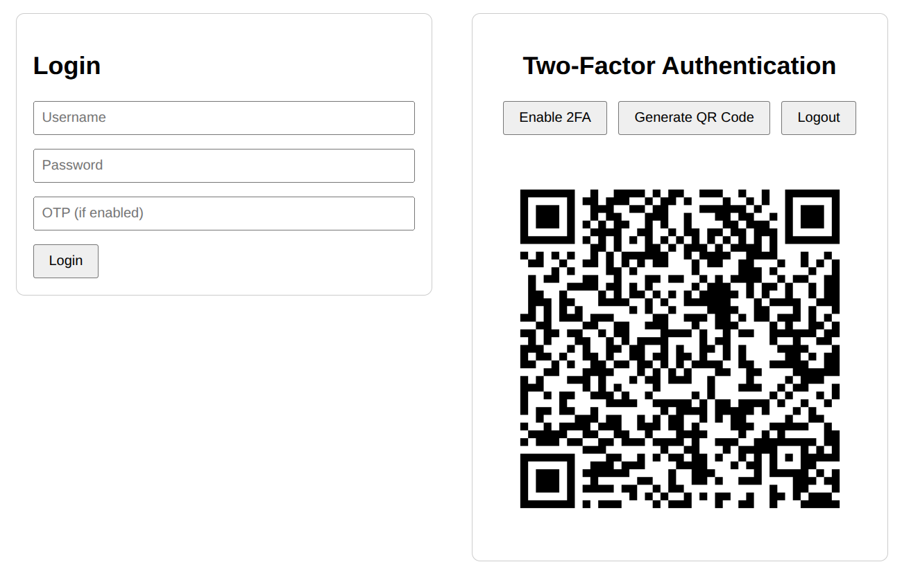

# FastAPI Two-Factor Authentication Example

This repository demonstrates a minimal implementation of Two-Factor Authentication (2FA) using [FastAPI](https://fastapi.tiangolo.com/), `pyotp`, and `qrcode`. The example covers basic authentication, token-based access, and optional TOTP-based 2FA.

## Features

- Basic authentication using FastAPI's security utilities
- Token-based session management (for demonstration; use JWT in production)
- QR code generation for easy setup in authenticator apps
- Example endpoints for enabling/disabling 2FA and verifying OTP codes

## Endpoints

- `POST /auth/credentials`: Authenticate with username and password. Returns a token if successful. If 2FA is enabled, requires an OTP query.
- `PUT /auth/otp/enable`: Enable or disable 2FA for the authenticated user.
- `GET /auth/otp/generate`: Generate a QR code for setting up TOTP in an authenticator app.
- `GET /whoami`: Returns the username of the authenticated user.

## Usage

### Setup

```shell
python3 -m venv .venv
source .venv/bin/activate
pip install poetry
poetry install
```

### Run

```shell
fastapi dev ./src/auth/main.py
```

The app will listen on port `4000`.

### Example Workflow

1. **Authenticate and get a token:**
    ```shell
    curl -X POST "http://localhost:8000/auth/credentials" -u user:pass
    ```
2. **Enable 2FA:**
    ```shell
    curl -X PUT "http://localhost:8000/auth/otp/enable" \
    -H "Authorization: Bearer <TOKEN>" \
    -H "Content-Type: application/json" \
    -d '{"enabled": true}'
    ```
3. **Generate QR code for authenticator app:**
    ```shell
    curl -X GET "http://localhost:8000/auth/otp/generate" \
    -H "Authorization: Bearer <TOKEN>" --output qr.png
    ```
4. **Authenticate with OTP:**
    ```shell
    curl -X POST "http://localhost:8000/auth/credentials?otp=<OTP>" -u user:pass
    ```

Alternatively, you can interact with the API using the built-in Swagger UI at [`localhost:8000/docs`](http://localhost:8000/docs) or the ReDoc interface at `localhost:8000/redoc`. For a more streamlined experience, a simple web UI is also available for testing at `localhost:8000/static/index.html`.

<p align="center">
    
</p>

## Notes

- This example uses in-memory data structures for demonstration. Use a proper database in production.
- Passwords are stored in plain text for simplicity. Always hash and salt passwords in real applications.
- Tokens are random strings; consider using JWT for production use.
- Use HTTPS in production environments.
